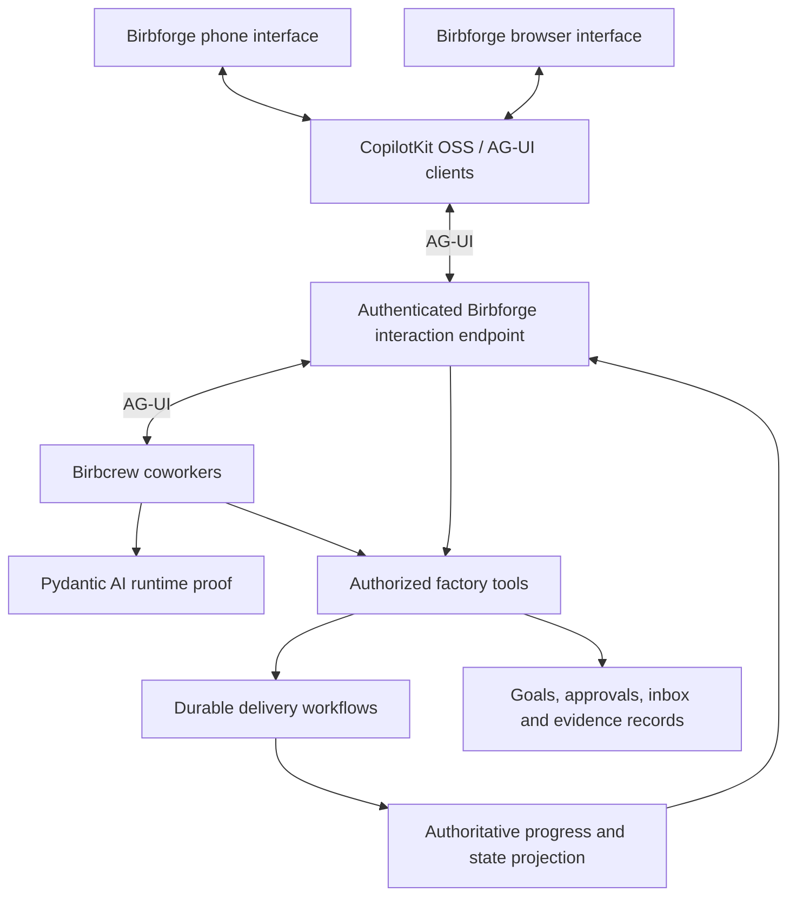

# AG-UI across Birbcrew and Birbforge

Status: required protocol, proposed architecture. Researched November 5, 2026.
AG-UI is mandatory in both projects. A2UI is optional. No integration has been
implemented or live-tested. CopilotKit Intelligence remains excluded.

The owner approved self-hosted Temporal and Pydantic AI as the first runtime
to validate. See the [runtime recommendation](runtime-recommendation.md).
Pi SDK remains the alternative if that proof fails. Neither integration has
been proven end to end.

## Product boundary

Birbcrew provides persistent coworkers through an AG-UI interface. Birbforge
uses AG-UI throughout the chief-of-staff conversation, agent activity, and
interactive decision surfaces on phone and browser. This is a shared interface
between the products, not a chat widget added after the factory is built.

Use standard lifecycle, text, tool, and state events where they fit. Scope
factory-specific data within the protocol's supported state and extension
mechanisms; avoid inventing a parallel agent event protocol. AG-UI provides
framework-independent interaction and supports multiple transports.
[Protocol overview](https://github.com/ag-ui-protocol/ag-ui),
[event concepts](https://github.com/ag-ui-protocol/ag-ui/blob/main/docs/concepts/events.mdx)

## What the user experiences

| Surface | Role for AG-UI |
| --- | --- |
| Chief-of-staff conversation | Stream responses and tool activity; accept follow-up input |
| Goal planning | Share plan state and collect the owner's decisions |
| Inbox detail | Present the same decision request and evidence referenced in conversation |
| Active work | Project authoritative task progress, with links to specialist sessions |
| Human review | Surface requests and return responses to the authorized action handler |
| Device switching | Reconnect to the same thread/run identities and recover current state |

Example: the owner asks which PR needs attention. The chief of staff reads
actual review records and presents a review card. The owner can resolve that
request in conversation or from the inbox. Both routes address the same request
ID and revision; the server validates actor, policy, and freshness before
recording the decision. A card is not itself approval evidence.

Stable navigation, lists, configuration, and artifact upload/download can use
ordinary application APIs. AG-UI is the agent interaction contract, not a
requirement to encode every HTTP operation as an agent tool call.

## Runtime options

AG-UI does not require replacing pi or selecting a particular language.
The inspected upstream integration list does not include a pi adapter, and
the inspected pi repository search found none; this is not a claim that no
community adapter exists.

TypeScript with pi remains viable: its SDK exposes sessions, custom tools,
streamed messages, tool events, and run lifecycle signals. Birbcrew would map
those to AG-UI using the official protocol types/encoders. That adapter must
handle stable IDs, ordering, terminal outcomes, cancellation, snapshots, and
reconnection. This is bounded integration work, but it is more than renaming
token events. Keep provider logic, coding tools, and context management in pi.
[Pi SDK](https://github.com/earendil-works/pi/blob/main/packages/coding-agent/docs/sdk.md)

Python with Pydantic AI is the selected first proof because it provides documented
AG-UI and Temporal integrations. Durable execution still requires starting a
workflow; simply invoking the UI adapter from an HTTP endpoint does not make
the run durable. Its documented event-stream bridge is relevant to evaluating
this combination. Native subscription compatibility and coding-agent delegation
remain separate acceptance requirements.
[Pydantic AI AG-UI](https://pydantic.dev/docs/ai/integrations/ui/ag-ui/),
[Temporal integration](https://pydantic.dev/docs/ai/capabilities/durable_execution/temporal/)

Prove the selected Pydantic AI path with conversation, tool, interruption,
restart and reconnect journeys. Evaluate pi only if that proof fails. Existing AG-UI
integrations also include Mastra, LangGraph, and Google ADK; protocol support
alone does not establish a better fit for the complete factory.

## A2UI's optional role

The linked Google article describes A2UI as declarative interface data, with
AG-UI transporting it to a client renderer. This can let the chief of staff
compose relevant cards and controls from an approved catalog.
[Google's article](https://developers.googleblog.com/build-generative-ui-apps-with-a2ui-copilotkit-agents/)

Core views and approval controls should be trusted application components,
available through both inbox and conversation regardless of A2UI support.
Optional generated layouts can reference these components without gaining
authority to approve, merge, or modify policy.

Do not assume React Native AG-UI support means equivalent A2UI renderer support.
The A2UI renderer directory lists stable React web support, while React Native
appears as a community renderer for an older protocol version. Validate exact
versions and behavior before adopting it; do not build a new general renderer
as a prerequisite for the factory.
[Renderer matrix](https://a2ui.org/reference/renderers/),
[CopilotKit React Native](https://docs.copilotkit.ai/react-native)

## Persistence and control

AG-UI standardizes interaction; it does not provide our database, durable job
engine, authentication, or merge authorization. Closing a stream must not
implicitly cancel background work. Explicit cancellation is a separate action
with an acknowledged outcome. Reconnection must recover a coherent snapshot
and supported event history without creating another run.

Store or reconstruct user-facing conversation history through the chosen
framework and independent persistence components. Keep workflow history and
conversation history distinct. Server-owned records determine approvals and
delivery status; client-supplied state cannot grant permissions.

## Proposed proof

One thread should demonstrate streaming, a factory-tool call, an input request,
phone/browser reconnection, and a worker restart without duplicate work. Then
resolve a revision-bound review from one device and observe its resolved state
on the other. Run this without Intelligence and without A2UI first. Optional
A2UI presentation must not change the authority or outcome of those actions.
