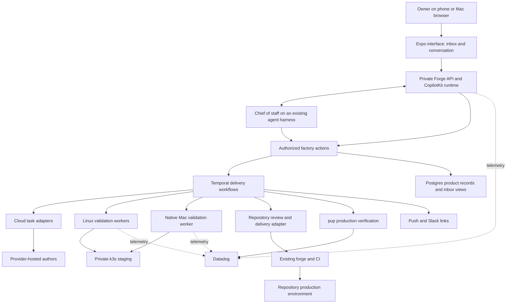

# Component options for Forge

Research date: November 5, 2026. The owner approved self-hosted Temporal and
Pydantic AI as the first Crew runtime to validate. Other component proposals
remain subject to their stated proofs. No services were deployed or paid integrations
activated. Repository documentation and public upstream sources were inspected;
compatibility and operational claims below still need a targeted live proof.

## Recommendation

Use **CopilotKit's open-source TypeScript runtime and client SDKs, Temporal,
PostgreSQL, and existing agent harnesses**. Build Forge's delivery policy and
user experience around them. Keep the initial deployment private on k3s, with
a native Mac worker for validation that requires macOS.

The owner has selected [Crew](https://github.com/mattsp1290/crew) to
replace crabber-coworkers. Its responsibility is reusable persistent coworkers.
Python with Pydantic AI is the approved first runtime to validate. TypeScript
with pi remains an alternative if that proof fails. AG-UI is mandatory and
central to both Crew and Forge;
A2UI is optional. Forge retains the factory interface and delivery policy.
Temporal is the selected durable execution engine. These decisions authorize
readiness planning, not implementation. See [AG-UI architecture](ag-ui-architecture.md).

The [runtime recommendation](runtime-recommendation.md) develops the next
decision. Temporal is the shared coordinator, with Pydantic AI as the first
Crew integration proof and pi SDK as the alternative. It also records the owner's confirmation
that the Mac is already joined to the k3s setup and the requirement to reuse
Birbhomes' guest/native execution paths and lifecycle controls.

Temporal is the preferred workflow engine for our combination of distributed
workers, long human waits, independent review, serialized production delivery,
and recovery. It costs infrastructure effort. This recommendation favors owning
that deployment over owning the corresponding scheduling and recovery code.

DBOS is the strongest smaller alternative. Reconsider it if we deliberately
start with one coordinator process and accept the documented recovery model.
Do not quietly grow a custom distributed coordinator around it.

CopilotKit Intelligence is explicitly excluded by the owner, both hosted and
self-hosted. It is not a future upgrade option. Use the standalone open-source
SDK/runtime path and independent conversation persistence. This supersedes the
earlier suggestion to consider Intelligence as a paid option.

## What the local projects teach us

Crabber's inspected workspace owns model providers, authentication, agent
execution, session stores, tools, extension loading, WASM support, durable
controls, event delivery, and telemetry. Its README discusses recovery and
ambiguous outcomes in detail. These are legitimate runtime concerns, but most
are not Forge's differentiating product behavior.

Agentcraft's inspected README adds native Apple clients, remote workers,
deployment tooling, a GitHub catalog service, and a custom Codex credential
broker. Its vision of remote execution and inspectable results remains useful.
We should not automatically inherit its services or authentication machinery.

These observations come from documentation and workspace structure, not a
line-by-line quality audit. Existing repositories remain untouched. Reuse
proven lessons and acceptance journeys before copying implementation.

## Who owns what

| Responsibility | Proposed owner | Forge's remaining work |
| --- | --- | --- |
| Phone and browser rendering | Expo, React Native, React Native Web | Inbox, goals, review/evidence screens, responsive layouts |
| Agent conversation and interactive cards | CopilotKit clients and TypeScript runtime, AG-UI | Register factory actions and map runtime events |
| Reasoning, coding tools, context management | Codex, Claude Code, pi | Configure roles, skills, permissions, and supported invocation paths |
| Reusable persistent coworkers | Crew using an existing agent framework | Required AG-UI interface; choose runtime and durability integration |
| Verification execution and evidence | Verify using repository-owned tests and deployment procedures | Define acceptance policy, bind evidence to candidate revisions, and surface progress through AG-UI |
| Workflow history, retries, durable waits, task routing | Temporal | Define the actual delivery workflow and activity contracts |
| Authored work and shared knowledge | Beans | Scoped access, provenance and safe mutation integration |
| Delivery records and queryable views | PostgreSQL | Accepted scope snapshots, policies, approvals, PR bindings, inbox projections |
| CI and deployment | Each repository's existing CI and deployment tools | Trigger or observe the correct revision and collect evidence |
| Observability | Datadog and existing collectors/SDKs | Correlation, factory signals, dashboards, production health policy |
| Production health investigation | pup CLI | Run bounded, repository-specific queries and retain evidence |
| Slack and phone delivery | Existing Slack/push APIs or SDKs | Destinations, notification rules, delivery receipts, deep links |

No new model-provider SDK, shell/file tool library, agent context compactor, or
generic job scheduler belongs in the initial Forge scope.

## CopilotKit: buy the right layer

The open-source SDKs and **TypeScript** runtime can operate without an
Intelligence service. They cover chat, agent state, frontend tools, and
generative UI. Framework- or application-owned history remains supported but
requires integration. Other runtime languages currently have different
Intelligence requirements, which makes TypeScript the practical default here.
[Source: open source versus Intelligence](https://docs.copilotkit.ai/concepts/oss-vs-enterprise)

React Native has provider/hooks and optional rendered chat components. Its
headless entry point helps us share application behavior while choosing
appropriate phone and browser presentation. Expo explicitly supports React
Native Web; this does not imply every third-party component is universal.
[CopilotKit native guide](https://docs.copilotkit.ai/react-native),
[Expo web guide](https://docs.expo.dev/workflow/web/)

| Product | Useful capabilities | Decision for Forge |
| --- | --- | --- |
| CopilotKit OSS | Conversation, tools, state, UI integration | Adopt as a dependency |
| Intelligence | Saved rich conversations, cross-device continuity, memories, learning | Explicitly excluded |
| OpenBot | Coworkers, governed tools, computers, routines, administration | Excluded as an application base because it requires Intelligence |
| OpenMuse | React Native personal-agent app with activity and goal surfaces | UX reference only; its application requires Intelligence |
| OpenDots | Spaces, persistent coworkers, pages, channels | Excluded as an application base because it requires Intelligence |
| Soar | Commercial coworker product built on OpenBot | Outside the selected standalone OSS path |

The following findings explain the evaluated templates; they are not adoption
recommendations. Do not fork these applications to remove Intelligence. Any
small reused component must be independently useful and free of that dependency.

OpenBot is MIT-licensed and beta. It now provides a published container and Helm
deployment guidance, so operating an unmodified instance does not require
building a fork. However, it explicitly describes itself as a template with
private workspace packages. Customizing its application still brings ownership
of a substantial codebase. Its external AG-UI endpoint support is useful; a
working Codex/pi bridge and factory merge policy remain to be proven.
[OpenBot README](https://github.com/CopilotKit/OpenBot/blob/main/README.md),
[deployment guidance](https://github.com/CopilotKit/OpenBot/blob/main/docs/deployment.md)

OpenBot's gateway governs actions routed through it. Translating an external
CLI's events into AG-UI does not by itself intercept that CLI's filesystem,
shell, or repository credentials. We must enforce factory actions through
controlled tools and credential boundaries. Its routines documentation also
describes scheduling limitations; a scheduled conversation is not evidence of
the full required delivery lifecycle.
[Architecture](https://github.com/CopilotKit/OpenBot/blob/main/docs/architecture.md),
[routines](https://github.com/CopilotKit/OpenBot/blob/main/docs/routines.md)

OpenMuse is an alpha template that already includes React Native, an activity
surface, and its own task-worker machinery. Its roadmap still lists device
push and a live OpenBot bridge as unfinished. Adopting it wholesale would mean
reworking personal-assistant features and deciding who owns its scheduler.
[OpenMuse README](https://github.com/CopilotKit/OpenMuse/blob/main/README.md),
[roadmap](https://github.com/CopilotKit/OpenMuse/blob/main/ROADMAP.md)

OpenDots is also an alpha template; it requires Intelligence for conversation
storage and has separate application/background-work state. It does not remove
our delivery-specific integration requirements. Soar is listed as early access
in CopilotKit's main repository. Neither is established here as a ready-made
software factory.
[OpenDots](https://github.com/CopilotKit/OpenDots/blob/main/README.md),
[CopilotKit product overview](https://github.com/CopilotKit/CopilotKit/blob/main/README.md)

Production self-hosted Intelligence currently requires a Team self-hosted or
Enterprise arrangement. It brings Postgres, Redis, identity configuration, and
multiple platform services. The free Mac/Docker local evaluation is a distinct
path, not an entitlement to run production on k3s. Neither path is in scope
for Forge, regardless of price or licensing.
[Production self-hosting](https://docs.copilotkit.ai/intelligence/self-hosting),
[local evaluation](https://docs.copilotkit.ai/intelligence/self-hosting-local)

## Durable workflow alternatives

These are architecture judgments for our requirements, not benchmark results.

| Candidate | Why consider it | Tradeoff | Verdict |
| --- | --- | --- | --- |
| Temporal | Distributed workers, durable history and waits, established workflow tooling | Service operation and deterministic workflow/versioning discipline | Preferred |
| DBOS | Workflows and queues in a library backed by Postgres | Distributed failure detection/recovery needs coordination; Conductor is separately licensed | Strong smaller alternative |
| Inngest | TypeScript workflows, flow controls, outbound-connected workers | Self-hosted operational configuration and server license differ from a permissive OSS library | Credible runner-up |
| Windmill | Ready-made scripts, flows, approvals, worker UI | Another application/control surface; some approval controls are paid | Useful if an operations platform becomes the primary requirement |
| LangGraph | Checkpointed agent graphs and human interrupts | Does not eliminate our existing-harness integration or deployment coordination work | Use only if the chief-of-staff reasoning needs it |
| pi-durable | Agent conversation/task durability close to pi | Explicitly experimental; adopting it does not prove the distributed factory lifecycle | Track, but do not make it foundational yet |

Temporal workers poll task queues and execute application code outside the
Temporal service. That suits separate Linux and Mac worker processes. Human
decisions can enter through workflow messaging; long waits need not keep a
coding agent busy. Temporal's server is MIT-licensed.
[Worker model](https://docs.temporal.io/workers),
[workflow messages](https://docs.temporal.io/encyclopedia/workflow-message-passing),
[license](https://github.com/temporalio/temporal/blob/main/LICENSE)

Temporal supports PostgreSQL for persistence and visibility; Elasticsearch is
not an unconditional requirement. We still need to size and operate a real
deployment, with backups, upgrades, monitoring, and private access. A developer
server is not the proposed production installation.
[Persistence](https://docs.temporal.io/temporal-service/persistence),
[self-hosting](https://docs.temporal.io/self-hosted-guide/deployment)

DBOS reduces the basic footprint to application processes plus Postgres. Its
documentation distinguishes automatic startup recovery on a single node from
distributed recovery coordination. Conductor supplies that coordination and
operations tooling; self-hosted Conductor requires a proprietary license. We
could choose DBOS without it, but should not conceal the recovery work that
would then remain ours.
[Architecture](https://docs.dbos.dev/architecture),
[Conductor deployment](https://docs.dbos.dev/conductor/self-hosting/hosting-conductor)

Inngest's connect workers make outbound connections, which fits private workers.
Its self-hosted default includes in-memory queue/state with periodic SQLite
snapshots; a durable deployment needs deliberate storage and crash-recovery
validation. The inspected server license is SSPL with an Apache future grant,
not the same license as Temporal. This is a selection fact, not a legal opinion
about a particular distribution.
[Connect](https://www.inngest.com/docs/durable-execution/deploying-functions/connect),
[self-hosting](https://www.inngest.com/docs/self-hosting),
[server license](https://github.com/inngest/inngest/blob/main/LICENSE.md)

Windmill provides a server, workers, and a Postgres-backed queue, plus approval
flows. Its documented authenticated-approver and no-self-approval options are
Cloud/Enterprise features. Our app could enforce policy around it, but that
reduces the benefit of adopting its approval surface. Native Mac execution
would need its own compatibility proof.
[Self-hosting](https://www.windmill.dev/docs/advanced/self_host),
[approval controls](https://www.windmill.dev/docs/flows/flow_approval)

LangGraph supplies useful checkpoint and interrupt semantics, but wrapping
existing coding agents in a graph is still integration work. Adding it alongside
Temporal and complete coding harnesses needs a specific benefit. pi-durable
also deserves attention, but its README warns that APIs change without notice.
[LangGraph design](https://docs.langchain.com/oss/javascript/langgraph/thinking-in-langgraph),
[pi-durable](https://github.com/earendil-works/pi/blob/main/packages/durable/README.md)

## Agent execution without recreating pi

Use pi through its SDK or RPC when pi is the selected harness. It already owns
the agent loop, coding tools, session behavior, and extension mechanism. Its
documentation explicitly leaves isolation to the host, so workspaces and
credentials still need appropriate execution boundaries.
[Pi](https://github.com/earendil-works/pi/blob/main/README.md)

For Codex, favor its existing app-server interfaces for interactive sessions.
Managed ChatGPT authentication and rate-limit reporting already exist; we
should not write another refresh-token broker. The installed cloud CLI exposes
submission, status, and diff operations, marked experimental. That establishes
a candidate integration, not successful unattended dispatch on this account.
[Codex App Server](https://learn.chatgpt.com/docs/app-server)

Claude Code has noninteractive CLI operation and documented cloud task flows.
Use supported native authentication/invocation paths rather than assuming a
subscription is interchangeable with any model API key. Validate each adapter's
session lifecycle and account behavior separately.
[Programmatic Claude Code](https://code.claude.com/docs/en/headless),
[cloud tasks](https://code.claude.com/docs/en/claude-code-on-the-web)

Automatic fallback is a workflow decision: preserve the approved brief, commit,
patches, evidence, and handoff summary, then start an attempt on an eligible
provider. Hidden model context is not a portable checkpoint. Reconcile unknown
submission outcomes before retrying, and keep reviewer independence intact.
GitHub, GitLab, and Forgejo need explicit provider capability checks; do not
assume a provider's hosted GitHub integration supports all three.

## Proposed architecture

The interface and API remain private through NetBird. External integrations use
outbound polling where practical; public forge callbacks cannot simply reach a
private endpoint. Workers contact the private workflow service. A provider's
hosted author is an external task, not implicitly a Temporal worker or a member
of the private network.

Temporal owns execution history. Beans owns authored work records and shared
notes. Product tables own accepted scope snapshots, policy revisions,
approval records, and queryable inbox data. They must not become a second
scheduler. Agent harnesses own their sessions; the UI needs a deliberate
history/reconnect adapter. That adapter is real work. Evaluate existing harness
history APIs and independent persistence components before implementing it;
Intelligence is excluded. Durable workflow history and user-facing conversation
history have different purposes, so Temporal alone does not supply chat replay.

Factory actions must be validated server-side. CopilotKit tool cards are an
interaction surface, not authorization. The chief of staff gets task-management
tools; protected merge/deployment actions use constrained credentials and
current policy checks outside the model's discretion.

## Custom code that earns its place

1. A shared action contract for the inbox and chief of staff.
2. Repository policies: approval categories, provider eligibility, verification,
   production health, and rollback rules.
3. Delivery workflows: owner assignment, independent review, staging acceptance,
   revision-bound approvals, environment sequencing, and recovery.
4. Adapters for runtime sessions, cloud tasks, forge operations, and evidence.
5. A focused phone/browser experience for goals, decisions, and outcomes.

For example, an environment workflow can own the merge-through-health queue
while task queues route work to Linux and Mac. This is our workflow definition
using Temporal's primitives, not a claim that Temporal understands PR policy.

Retries cannot make external actions exactly-once by declaration. Every merge,
cloud submission, notification, and deployment action needs an operation
identity and a way to reconcile what actually happened after an interrupted
response. Prefer provider-supported idempotency and recorded remote IDs.

Datadog instrumentation can use existing OpenTelemetry integrations. Put detailed
run/PR identifiers in traces and structured events; keep metric dimensions
bounded. Query production through pup, with repo-specific health criteria.
[Datadog OpenTelemetry support](https://docs.datadoghq.com/opentelemetry/instrument/)

## Proof before committing to the stack

Use one bounded pilot slice before broad scaffolding:

1. Phone and browser observe the same chief-of-staff conversation and inbox.
2. An approved goal dispatches one real provider task and records its remote ID.
3. Restart the coordinator during the task; recover without duplicate execution.
4. Validate the resulting revision on the Linux/Mac paths that actually apply,
   including the app deployed to k3s staging.
5. Request human review; reconnect on the phone and resolve the same request.
6. Demonstrate that stale approvals cannot authorize a newer revision, and that
   actual forge identities/protection rules enforce the intended review model.
7. Prove provider fallback from recorded artifacts and policy, without accidental
   paid overage or two competing owners.
8. Exercise merge/deployment observation and approved rollback against a
   disposable test target; do not induce a production incident to test recovery.
9. Follow the complete run in Datadog and deliver a private notification link.

The live pilot will expose adapter limitations earlier than building a large
dashboard. No benchmark, account entitlement, native compatibility, or production
recovery guarantee is implied by this research alone.
