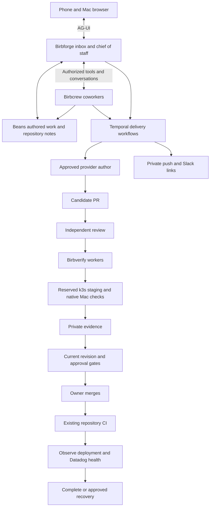

# Factory design checkpoint

Status: design agreed by the owner on November 5, 2026. HTML documentation authorized.
This describes the target system and the order in which to prove it. No runtime
integration or deployed acceptance test has passed in this documentation task.

## The experience

You approve a goal from your phone or Mac browser. A chief-of-staff conversation
helps refine the scope and shows the same decisions as the structured inbox.
The factory assigns a PR owner, obtains independent review, verifies the exact
candidate in k3s staging, and merges only when the required approvals are current.

The owner follows any production deployment triggered by existing CI. It uses
pup and Datadog to check the deployed revision against repository health rules.
If necessary, it follows an applicable human-approved rollback procedure,
verifies recovery, and prepares a repair. Uncertain recovery stops delivery and
requests help. Closing either client does not stop the factory.

## Components and their boundaries

| Component | Responsibility | Foundation |
| --- | --- | --- |
| Birbforge | Phone and browser UI, chief-of-staff tools, approved scope, inbox, review policy and delivery coordination | React Native direction; Expo and React Native Web proposed; AG-UI required; CopilotKit OSS |
| Birbcrew | Stable coworkers, separate goal conversations, durable waits, authorized tool use and reconnect | Approved first proof uses Python, Pydantic AI and self-hosted Temporal |
| Birbverify | Execute repository-owned verification journeys and produce evidence for the exact candidate | Existing test tools and Temporal activities |
| Beans | Authored requests, plans, issues, shared project notes and handoffs | Existing bn CLI and private Git-backed hub |
| Birbhomes | Private installation, Temporal and persistence operations, Linux workers and native Mac lifecycle | Existing k3s and NetBird setup |
| Birbparty | First complete feature pilot | Existing chat, plus emoji support and six creator-uploaded custom emojis |

AG-UI carries conversations, agent progress and user-facing state across
Birbcrew and Birbforge. Authenticated server actions enforce decisions regardless
of whether they originate in conversation or the inbox. A2UI is optional.
CopilotKit Intelligence is excluded.

PostgreSQL is the proposed application store for finalized messages and factory
records. Temporal owns execution and waits. Beans owns authored work and shared knowledge. Large
evidence files use private artifact storage. These responsibilities do not
require a separate service or database server for each row.

## A goal through the system

The diagram shows logical responsibilities, not a selected internal wire format.
Birbforge owns the environment queue. Birbverify supplies execution activities.
Workers cannot grant themselves access by requesting a capability.

## Rules that constrain autonomy

- Only human-approved goals execute. Follow-up ideas enter the inbox.
- The PR owner cannot approve its own work. Approval and verification bind to
  the revision and accepted scope. A changed candidate requires fresh evaluation.
- Human review is always required for authentication, permissions, destructive
  migrations, secrets, credentials and production infrastructure changes.
- Agents can request human review for other work with the evidence and decision needed.
- Shared staging stays reserved through deployment, checks and cleanup.
  Uncertain worker ownership or cleanup quarantines the environment.
- Merge, deployment and production observation serialize per deployment environment.
- Fallback uses approved subscriptions and eligible integrations. It preserves
  scope and reviewer independence. Paid overage requires separate authorization.
- Repository notes provide context. They cannot grant approval or expand scope.

## Private operation

Phone and browser access use private NetBird connectivity and application
authentication. Normal actions work on both devices. Desktop-only CLI setup is
acceptable. The initial Mac UI runs in a browser. Tauri remains a later option.

Phone push and Slack deliver actionable notices and links. Approval happens in
Birbforge. Public examples contain placeholders. Installation destinations,
credentials, infrastructure addresses and evidence stay private.

Datadog tracks factory progress, failures, provider fallback and deployment
health. High-cardinality identities belong in correlated logs and traces.
Telemetry does not replace authoritative execution or approval records.

## Implementation sequence

1. **Birbcrew proves the foundation.** Two AG-UI clients share a persistent
   conversation. Disconnect, restart, human input and an interrupted tool reply
   recover correctly. Read scoped notes from a disposable Beans hub. Prove one
   eligible live subscription path as well as deterministic recovery tests.
2. **Owners work against the proven contracts.** Birbforge builds the phone and
   browser journey. Birbverify proves attributable execution and recovery.
   Beans proves safe note writes. Birbhomes establishes deployment prerequisites.
3. **Birbparty supplies the complete pilot.** Deploy the exact emoji candidate
   to shared k3s staging and exercise the feature. Existing production is not
   the pre-merge test target.
4. **Delivery gains production follow-through.** Exercise independent approval,
   merge, CI observation, Datadog checks and repository-approved recovery before
   granting unattended production responsibility.

Each repository gets a human-started poteto-mode owner in Codex, with Claude CLI
for independent review. Those sessions build
the factory. They do not assume that its future automated coordination exists.

## Choices still open

Beans ownership of authored work and shared notes is agreed. Birbforge retains
revision-bound approvals and delivery records. Codex with Claude CLI review is
the selected host for the implementation sessions. The launch guidance must
map pstack roles to those available tools without assuming Cursor-only APIs.

Deployment milestones must select application identity, secret storage,
artifact storage and retention, worker placement and native Mac isolation.
They must also prove cloud dispatch, multi-provider eligibility and fallback.
These are explicit deployment gates. They do not prevent the isolated first
Birbcrew proof. The source research does not establish live compatibility.

One eligible subscription path is required to accept the first Birbcrew milestone.
Confirm supported login, eligibility and settings preventing unapproved overage
before that live check. Broader fallback comes later.

Birbparty still needs exact emoji scope, asset limits, replacement behavior and
native acceptance details before feature execution. Existing staging and native
toolchain readiness require live verification.

The owner's agreement authorizes turning this design into the requested
HTML documentation with these unresolved gates visibly labeled. It does not
approve unselected deployment products or launch implementation agents.

## Supporting records

- [Accepted product decisions](design-decisions.md)
- [Runtime recommendation and sources](runtime-recommendation.md)
- [AG-UI architecture](ag-ui-architecture.md)
- [Beans integration](beans-integration.md)
- [Verification contract](verification-contract.md)
- [Repository owners](repository-owners.md)

The design-agreement gate is satisfied. The remaining launch gate is documented
in [the repository owner guide](start-repository-owner.md).
