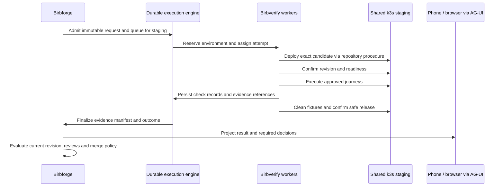

# Verification contract: Birbforge, Birbcrew, and Birbverify

Status: design proposal, November 5, 2026. Repository roles, k3s staging, and
queuing against shared staging are agreed. The detailed contract below is a
proposal for review, not implemented functionality or a selected wire format.

## The promise

Given an approved verification plan and an immutable candidate, Birbverify runs
the specified checks in the permitted environment and returns attributable
evidence. Birbforge decides whether that evidence satisfies delivery policy.
An agent's narrative cannot replace a missing check or authorize a merge.

The first version queues runs against the existing shared k3s staging
environment. Reserve it from deployment through all checks and cleanup. Linux
and Mac checks may run concurrently only when their fixtures and actions do not
interfere. Per-PR preview environments remain a later option.

## Ownership

| Component | Owns | Does not own |
| --- | --- | --- |
| Birbforge | Approved goals, acceptance plan, policy, durable delivery workflow, environment queue, evidence index, reviews and merge gates | Agent reasoning engine or application tests |
| Birbcrew | Persistent coworker sessions, authorized factory tools, explanations and review assistance through AG-UI | Authority to invent human approval or change required checks |
| Birbverify | Verification activities, worker capability matching, execution adapters, evidence manifests and result reporting | A second scheduler, merge policy or a new testing framework |
| Application repository | Feature tests, user journeys, deployment and recovery procedures | Authority for an unreviewed candidate to weaken installation policy |
| Birbhomes | Worker and cluster provisioning, private access and infrastructure configuration | Application acceptance rules |

Separate repositories do not require separate databases or a new service per
responsibility. Initially, Birbforge's Temporal workflows should
dispatch Birbverify's worker activities. Birbcrew invokes authorized Birbforge
tools; it does not bypass admission by sending arbitrary jobs to workers.
Temporal is selected. Concrete worker transport and language bindings remain
implementation choices to prove.

## Request: what Birbforge supplies

Requests are versioned, immutable records. A retry creates another attempt
under the same request; a changed candidate or plan creates a new request.

| Field group | Required meaning |
| --- | --- |
| Identity | Contract version, request ID, goal ID, PR identity, correlation ID, submission idempotency key |
| Candidate | Repository identity, exact source commit, PR head, base commit when relevant, and whether the checked artifact is the head or a resolved integration commit |
| Plan | Immutable acceptance-plan revision/digest, required check IDs, assertions, procedure references pinned to revisions, and evidence requirements |
| Authority | Submitting principal, authorizing workflow, policy revision, permitted environment and operations |
| Target | Logical environment ID, expected application components, artifact references/digests when available, and deployed-revision identification method |
| Resources | Worker capabilities, fixture requirements, bounded execution deadlines, retry budget and cleanup procedure |
| Evidence | Required artifact types, access classification, retention policy reference, and telemetry correlation |

Environment IDs resolve through private installation configuration. Requests
contain secret references rather than credentials. Workers fetch only the
capabilities and credentials required for their assigned activity. A requested
capability is not itself a grant of access.

Use repository-native procedures first. A procedure reference can identify a
verification skill plus executable checks; it need not force every repository
into a new command framework. Record the exact instructions and tool versions
used. Agent-driven journeys must retain observations and action records as
well as their conclusions.

The accepted plan derives from approved scope and trusted policy. Candidate
test changes are visible for review and cannot silently delete required
assertions. Installation constraints take precedence; repository rules can
add restrictions. Conflicts stop admission and surface a decision request.

## Execution and environment ownership

The reservation covers the whole shared environment journey, including a Mac
worker testing the application deployed by a Linux worker. The owner confirms
the Mac is already joined to the k3s setup. Reuse Birbhomes' documented Linux
guest and native macOS runner paths on that host, including their existing
lifecycle gates. Native Apple tools run on macOS; Linux container jobs run in
the guest. Current toolchain readiness remains to be verified. CI, manual
deploys, and other writers must
respect the reservation or be detected as interference. Check deployed identity
before and after the journey; record deployment changes during the interval
where the environment supports that evidence. A single successful rollout is
insufficient proof that the intended candidate was tested throughout.

Birbforge's Temporal workflows coordinate durable queue ownership and
leases. Do not implement another general-purpose queue in Birbverify. Expired
ownership must not let an old worker continue mutating staging while a new run
starts. Use supported fencing at mutation boundaries and reconcile running
processes and deployments before handing over the environment. If ownership
or termination is uncertain, quarantine staging and surface an operational
request rather than overlap runs.

Isolate each checkout and its writable files. Use synthetic test identities and
fixtures. Candidate code and agent-produced commands remain untrusted input;
they do not inherit production credentials or authority to alter the plan.
Isolation for native Mac execution is an explicit implementation requirement
still to be selected, not something a worktree alone provides.

## Lifecycle and outcomes

Track lifecycle separately from what the checks established:

| Lifecycle | Meaning |
| --- | --- |
| Queued | Admitted and waiting for resources/environment |
| Running | An identified attempt owns execution |
| Finalizing | Evidence and cleanup outcomes are being reconciled |
| Terminal | Immutable outcome and evidence manifest recorded |

| Terminal outcome | Meaning |
| --- | --- |
| Passed | Every required assertion passed with required attributable evidence |
| Failed | At least one required assertion demonstrably failed |
| Inconclusive | Infrastructure, missing evidence, skipped required checks, or environment interference prevented a conclusion |
| Cancelled | Cancellation was acknowledged and execution stopped |
| Superseded | A newer candidate or plan replaced this request; its evidence remains historical |

Each check records its own outcome, including not-run reasons, even when the
overall run fails early. Track cleanup separately as complete, failed, or
unknown. A passed assertion set with failed cleanup does not release staging
or make the complete delivery gate green. Cancellation requested is not the
same as cancellation acknowledged; unresolved processes retain the reservation
or quarantine until reconciled.

Worker loss does not prove application failure. A demonstrated assertion
failure remains in history even if a later attempt passes. The proposed default
is bounded automatic retry for transient infrastructure failures; assertion
failures go to the owner for repair or explicit flaky-test investigation.
Every retry carries its reason and links to prior attempts.

Admission with the same idempotency key and identical payload returns the same
request. Reusing the key with a different payload is an error. External effects
such as deploys, uploads and fixture creation require their own stable operation
identities and reconciliation. Workflow durability alone does not make those
effects exactly once. Never blindly repeat a deployment with an unknown result.

## Result: what Birbverify returns

The result is a machine-readable manifest plus a concise human summary. Large
artifacts live in private artifact storage, not inside protocol events.

| Evidence group | Contents |
| --- | --- |
| Provenance | Request/attempt IDs, worker identity and capabilities, tool versions, source and plan revisions, policy revision, timestamps |
| Deployment | Observed revision, immutable image/artifact identifiers, environment ID, readiness evidence and interference observations |
| Checks | Required check ID, assertion, outcome, observations, duration, command/action record and not-run reason where applicable |
| Artifacts | Stable artifact ID, type, size, digest, capture time, access classification and retention/expiry metadata |
| Operations | Retry history, cancellation acknowledgement, fixture cleanup and environment-release outcome |
| Summary | What worked, what failed, what remains unknown, and links to the underlying evidence |

Authenticate worker submissions and restrict who can finalize manifests.
Artifact digests detect substitution but do not prove that an honest or
independent check occurred. Record provenance and reviewer independence; do not
call the manifest a cryptographic attestation unless such a system is actually
implemented. Artifact access is authorized on demand; do not store permanent
public links or expiring download URLs as the artifact identity.

Private artifacts are the default even for public repositories. Redact secrets
before upload; apply stricter handling to screenshots, recordings and logs.
Missing, expired or inaccessible required evidence is visible to the merge gate.
Exact retention duration and storage software are still open decisions.

## Freshness and merge decisions

Birbforge checks the result against the current PR, approved plan, required
reviews and current policy at decision time. A new PR head invalidates the old
candidate's verification. If verification covered an integration commit, a
changed base requires evaluating that relationship again; never relabel a
different commit as tested. The merge strategy must preserve a documented
relationship between tested and merged artifacts. CI and production health
then verify the actual deployed revision after merge.

No Birbverify result approves a PR by itself. Independent AI review and required
human decisions remain separate records bound to the revision. Changing a test
or acceptance rule requires review appropriate to that change, rather than
treating a new green report as sufficient.

Production observation can later reuse read-only Birbverify adapters, including
pup. The first staging contract does not grant production deployment or rollback
authority. Birbforge retains those separate, repository-governed workflows.

## AG-UI, inbox and Datadog

Birbforge projects authoritative verification state through AG-UI so the chief
of staff, inbox and phone/browser screens share the same request, attempt and
decision identities. Display check progress, evidence links, queue position
when known, and reasons for intervention. Use supported AG-UI state/tool events;
do not invent a second user-facing agent protocol.

Closing a stream does not cancel verification. Reconnecting reads the current
snapshot and available history. Retry and cancel actions pass through the same
authorized handlers whether invoked from a card or a coworker conversation.
The client cannot mark a check passed by editing shared state. A2UI is optional.

Emit Datadog telemetry for queue waits, run durations, check outcomes, retries,
worker loss, cleanup failures and evidence persistence failures. Keep request,
PR and commit identifiers in correlated logs/traces rather than unbounded metric
labels. Telemetry is diagnostic evidence; authoritative run state remains in
the chosen durable backing system.

## First complete pilot

For Birbparty, use the repository's existing staging deployment guidance and
Birbhomes infrastructure rules. Verify the deployed livestream/chat application
on k3s; local unit tests alone cannot satisfy the feature acceptance plan.

The proposed journey covers creator upload of six custom emojis, rejection of
a seventh, viewer use and receipt during a livestream, authorization of emoji
management, and corresponding native-app behavior. Exact channel scope,
replacement/deletion behavior, asset restrictions and native acceptance details
still need agreement before execution.

The first contract proof should also exercise worker interruption, duplicate
submission, a stale PR head and a second run waiting for shared staging. These
are acceptance scenarios for implementation, not tests claimed to have run.

## Decisions still needed

- Temporal worker placement and the runtime used by each verification worker.
- Concrete request/result schema and compatibility rules.
- Private artifact storage, retention and native-worker isolation.
- Repository policy location, trusted revision and review procedure.
- Pilot acceptance details and full staging readiness.

The owner approved HTML with these unresolved deployment gates labeled. They
do not block the isolated contract proof. Resolve them before accepting real
candidate execution on staging.
